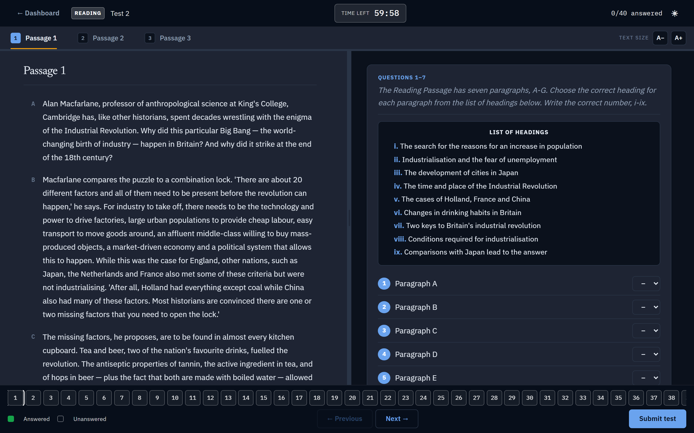
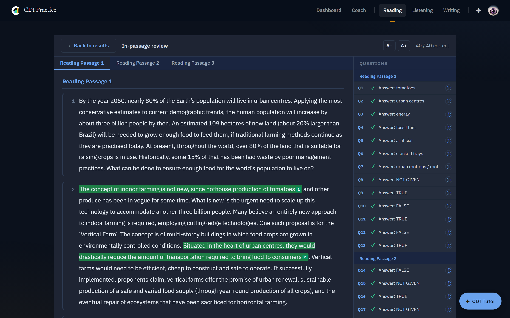
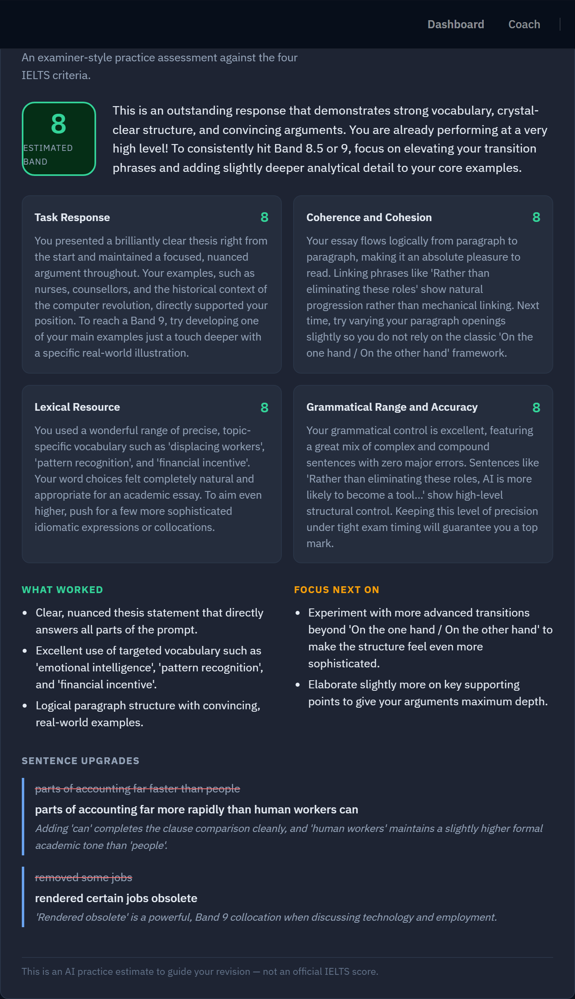

# CDI Practice — Computer-Delivered IELTS

A web app for practising **IELTS Academic Reading, Listening, and Writing** under
real computer-delivered exam conditions — then seeing exactly *why* every mark was
given, with each answer traced back to the line of the passage or transcript that
proves it.

**Live:** https://cdi-practice.vercel.app



## What it does

- **Authentic exam interface** — Reading and Listening in the exact
  computer-delivered format: countdown timer, split passage/question view,
  question palette, single audio playback ("plays once, no rewind").
- **Instant band score** — raw score converts to an IELTS band on submit, with a
  breakdown by section, question type, and where the time went.
- **Evidence-based review** — every answer is shown against the correct one, with
  the exact supporting sentence highlighted in the passage/transcript.
- **AI writing feedback** — examiner-style assessment across all four IELTS
  criteria, plus concrete sentence upgrades (powered by Gemini, server-side).
- **CDI Tutor** — an in-app AI tutor for questions about strategy, grammar, and
  vocabulary.
- **Accounts & progress** — target-band goals, per-attempt history, profile, and
  a light/dark theme.

| Evidence-based review | AI writing feedback |
|---|---|
|  |  |

## How the marking works

Answers are **graded on the server**, never in the browser. Before submission the
client only ever receives an answer-stripped view of each test (a `tests_public`
Postgres view); the real key stays server-side. After a learner submits, a
`SECURITY DEFINER` RPC returns the review content only for attempts they own that
have actually been submitted. This keeps the answer key out of the client while
still powering the rich post-exam review.

## Tech stack

- **Frontend:** React 18 + Vite, React Router, plain CSS (design tokens, light/dark)
- **Backend:** Supabase (Postgres, Auth, Storage) with Row-Level Security; grading
  and AI calls run through same-origin serverless functions (`/api`)
- **AI:** Google Gemini (server-side only — the key is never bundled into the client)
- **Hosting:** Vercel (auto-deploys `main`)

## Architecture at a glance

```
Browser (React/Vite)
  ├─ reads tests via  tests_public  (answers stripped)   ─► Supabase Postgres (RLS)
  ├─ submits answers ─► /api/grade   (server-side scoring, service role)
  ├─ review          ─► get_review_content() RPC (ownership + submitted checks)
  └─ AI tutor / writing feedback ─► /api/tutor, /api/writing-feedback ─► Gemini
```

## Running locally

**Prerequisites:** Node 18+ and Git.

```bash
# 1. Install dependencies
npm install

# 2. Copy the env template and fill in your credentials
cp .env.example .env
# VITE_SUPABASE_URL, VITE_SUPABASE_ANON_KEY  (client, safe to expose)
# SUPABASE_SERVICE_ROLE_KEY, GEMINI_API_KEY   (server-side only)

# 3. Start the dev server (also serves the /api functions)
npm run dev        # http://localhost:5173

# Run the tests
npx vitest run
```

## Building for production

```bash
npm run build      # outputs to /dist; Vercel deploys on push to main
```

## Content

Reading and Listening material is sourced from the Cambridge IELTS practice books
(9+). Licensing has been handled by the project owner.
